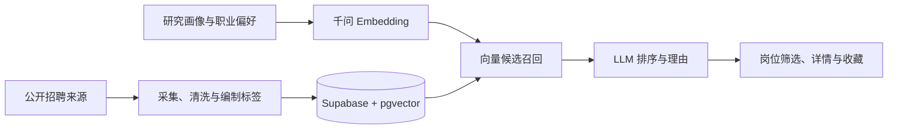

# PhDHunter · 博士个性化求职平台

> 公开展示副本：源于独立的私有开发仓库，使用全新提交历史。此仓库不包含生产密钥、数据库数据或用户画像；运行者需要配置自己的服务。

面向浙江省博士求职者的 Web MVP：聚合招聘岗位，提供编制标签、岗位筛选、收藏，以及结合研究画像与职业偏好的 AI 推荐。

## 核心流程

公开招聘来源 → 爬取与清洗 → Supabase 岗位库 → 千问1024维向量 → pgvector候选召回 → 千问排序及推荐理由 → 页面展示。

已有首页、岗位列表/详情、画像与偏好表单、推荐页、收藏页；包含六类来源适配、数据标准化、数据库迁移和每周采集工作流。来源适配器存在不等于当前网站均可正常采集。模型评分是推荐参考，不是经过校准的录用概率。

## 本地启动

需要 Node.js 20.9以上、npm、Supabase和通义千问账号。

```powershell
npm ci
Copy-Item .env.local.example .env.local
# 在本机填写环境变量，不提交真实密钥。
npm run dev
```

访问 http://localhost:3000。在 Supabase SQL 编辑器按文件名顺序执行 `supabase/migrations/`，配置 pgvector 及表权限。

环境变量见 `.env.local.example`。`NEXT_PUBLIC_SUPABASE_ANON_KEY`为前端只读访问；service-role和千问密钥仅用于服务端，不得赋予NEXT_PUBLIC前缀。

```powershell
npm run lint
npm test
npm run build
npx tsx scripts/crawl.ts --vectorize
```

最后一条会写入数据库并可能产生模型费用；不属于默认检查。GitHub定时采集需要配置工作流所列Secrets，不能仅凭workflow文件宣称自动更新已运行成功。

## 目录

- `src/app/`：页面与API。
- `src/components/`：岗位卡、筛选、画像/偏好等组件。
- `src/lib/matcher.ts`：向量召回、LLM排序与降级。
- `src/lib/crawler/`、`scripts/`：来源适配与采集、向量化入口。
- `supabase/migrations/`：数据表、权限与向量查询。
- `PRD.md`：产品设计；`TASKS.md`：早期规划，其勾选状态不代表最新验证情况。
- `docs/PROJECT_STATUS.md`：完成度评估与验证边界。

## 当前阶段

具备主要业务路径的MVP，尚未达到生产运营验收。仍需推荐输入和输出校验、并发限流、数据时效治理、真实全流程测试及推荐质量评估。涉及用户画像的模型调用会将相应文本发送到模型服务，应在正式上线前完善告知与使用规则。

本项目可用于展示需求分析、AI工具整合和产品迭代；请按实际承担部分说明个人贡献。未声明推荐准确率、用户规模或上线成效。


## 架构与产品价值



## 公开版本与安全边界

- `.env.local.example` 只包含占位符；本机的 `.env.local` 和部署环境变量不提交。
- 千问密钥与 Supabase service-role 仅在服务器使用；禁止放入 `NEXT_PUBLIC_*` 变量、网页代码或日志。
- `NEXT_PUBLIC_SUPABASE_URL` 与 anon key 是可公开的客户端配置，必须配合数据库 RLS；本副本仍仅提供占位示例。
- 未复制原仓库的 Git 历史、GitHub Secrets、部署配置、访问日志或用户数据。
- 采集工作流在本副本中没有定时触发，仅支持手动确认；默认 CI 不写数据库、不调用模型。
- 详情见 [SECURITY.md](SECURITY.md)。公开代码不等于公开数据库或模型账户。

## 验证

公开版本的自动检查见 GitHub Actions `Verify public source`：密钥特征检查、lint、离线测试和生产构建。检查不包含真实模型、数据库或爬虫联调。
