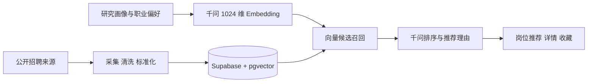

# PhDHunter · 博士个性化求职平台

### 将招聘信息聚合、研究画像和 AI 推荐串成完整求职路径

面向浙江省博士求职者的 Web MVP：聚合公开招聘岗位，提供编制标签、条件筛选、岗位详情、收藏，以及结合研究方向和职业偏好的推荐理由。

这是经过脱敏的公开展示副本，使用独立提交历史；不包含生产密钥、数据库记录或真实用户画像。启动需要配置自己的服务。

**[产品设计](PRD.md) · [完成度与验证记录](docs/PROJECT_STATUS.md) · [安全说明](SECURITY.md) · [CI 检查](https://github.com/YangXiaoBo-YG/phdhunter-showcase/actions/workflows/verify.yml)**

**演示状态：** 当前提供源码与本地启动方式，暂无已验证的公开在线演示或页面截图。不会将概念图作为运行截图；现场演示需要自行配置服务后启动。

## 为什么做这个项目

博士求职信息分散，岗位标题难以完整表达专业要求，编制与招聘条件也需要进一步识别。这个项目把“找信息”和“判断适合自己”放进同一条产品流程：先聚合、标准化，再结合研究画像召回候选岗位并生成推荐理由。

## 用户可以完成什么

| 用户步骤 | 对应能力 |
|---|---|
| 浏览岗位 | 聚合列表、条件筛选与岗位详情 |
| 判断岗位条件 | 编制标签和结构化招聘字段 |
| 描述自身情况 | 研究画像、专业背景与职业偏好表单 |
| 获取候选建议 | 向量召回、LLM 排序及推荐理由 |
| 留下待申请岗位 | 收藏与后续浏览 |

## 推荐如何实现



向量用于候选召回，语言模型用于进一步排序和解释，代码包含异常时的降级路径。推荐分数是排序参考，不是经过校准的录用概率。存在六类来源适配器，不代表当前所有来源均已完成在线采集验收。

## 当前完成度

已有主要页面、招聘来源适配、岗位标准化、数据库迁移和推荐链路。公开版本 CI 包含密钥特征检查、lint、离线测试和生产构建；这些检查不调用真实模型、不连接生产数据库，也不等于完整端到端验收。

下一步重点是推荐输入 / 输出校验、并发限流、岗位有效期治理、真实来源联调和推荐相关性评测。具体历史验证记录和未完成事项见 [PROJECT_STATUS.md](docs/PROJECT_STATUS.md)，不以任务勾选数量代替完成度。

## 项目体现的能力

- 从博士求职场景出发设计岗位、画像、偏好和收藏的产品路径。
- 将招聘采集、数据标准化、向量数据库与模型排序组合成推荐系统。
- 保留推荐理由、异常降级和数据权限等实际工程问题的处理入口。
- 将公开展示代码与生产密钥、真实数据及私有开发历史分离。

未声明推荐准确率、用户规模或商业运营效果。个人经历介绍应按实际承担部分归属，代码与产品能力可以直接通过仓库检查。

## 我的角色：产品设计、研究与 Agent 协作

本项目由 YangXiaoBo-YG 从个人研究 / 使用需求出发主导产品定义，设计来源调查、数据核验、方法设计、工程实现与 UI 验收的 Agent 分工，通过人机协作持续迭代。重点是把研究问题转化为可运行、可检查的产品，并对来源与结果作最终判断。

**[产品设计与职责](docs/PRODUCT_PRD.md) · [Agent 协作与数据核验](docs/AGENT_WORKFLOW.md) · [简历 / 面试说明](docs/RESUME.md)**

职责说明区分 Agent 辅助开发 / 核验与生产脚本自动执行，实际运行结果以任务记录和代码验证为准。

## 本地启动

需要 Node.js 20.9+、npm、Supabase 与通义千问服务。CI 使用 Node.js 22。

```powershell
npm ci
Copy-Item .env.local.example .env.local
# 在本机填写服务配置，不提交真实密钥
npm run dev
```

浏览器打开 `http://localhost:3000`。在 Supabase SQL 编辑器按文件名顺序执行 `supabase/migrations/`，检查 pgvector 与 RLS 权限。环境变量说明见 [.env.local.example](.env.local.example)。

## 检查与采集

```powershell
npm run lint
npm test
npm run build
```

需要主动采集和向量化时再执行：

```powershell
npx tsx scripts/crawl.ts --vectorize
```

采集会写入配置的数据库，并可能产生模型费用。公开副本的采集工作流只支持手动触发，不把“存在工作流”表述为“生产自动更新已验证”。

## 仓库导航

| 路径 | 内容 |
|---|---|
| `src/app/` | 页面与服务端 API |
| `src/components/` | 岗位卡片、筛选和画像等界面 |
| `src/lib/matcher.ts` | 向量召回、模型排序与降级 |
| `src/lib/crawler/`、`scripts/` | 来源适配、采集和向量化 |
| `supabase/migrations/` | 表结构、权限及向量查询 |
| `tests/` | 离线回归测试 |
| `PRD.md`、`docs/` | 产品设计、验证记录与开发边界 |

## API 与用户隐私

千问密钥和 Supabase service-role 密钥仅用于服务端，不得添加 `NEXT_PUBLIC_` 前缀。客户端 anon key 需要配合数据库 RLS；本仓库提供占位配置。向模型提交研究画像意味着相关文本会发送到模型服务，正式上线前需要完善告知与使用规则。详见 [SECURITY.md](SECURITY.md)。

## 相关个人项目

[市场风险观察站](https://github.com/YangXiaoBo-YG/market-risk-refresh) · [Anatomy Video 技术视频工作流](https://github.com/YangXiaoBo-YG/anatomy-video)
